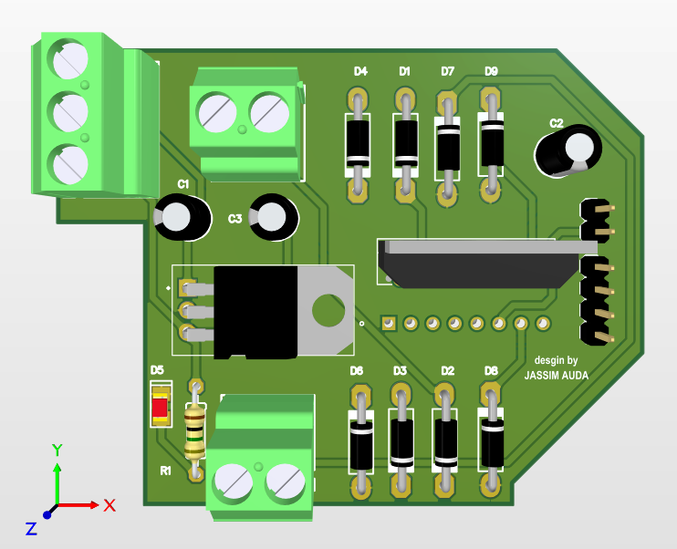

# L298N Motor Driver Board

A dual H-bridge motor driver board designed in Altium Designer, fabricated and functionally tested by the designer.

**Status:** v1.1.0 — revised hardware source and updated fabrication archives. Original revision v1.0.0 was fabricated and functionally tested, as reported by the designer; revised hardware has not yet been independently tested.

## Design Previews

[ Schematic ](Images/01-schematic.png) · [ 2D PCB layout ](Images/02-pcb-2d.png) · [ 3D PCB preview ](Images/03-pcb-3d.png)

Previews show the original v1.0.0 Altium design for reference, not the revised layout or photographs of the fabricated hardware.

## Hardware Overview

| Item | Design information |
| --- | --- |
| Motor driver | L298N |
| Logic supply regulator | L7805CV |
| Protection diodes | 8 × 1N4007 |
| Control signals | EN1, EN2, IN1–IN4 |
| Motor outputs | OUT1–OUT4 |
| Power nets | VCC, +5, GND |
| PCB fabrication data | Top and bottom copper, solder masks, overlays, paste layers and board profile |
| NC drill | 55 plated round holes across 5 tool sizes |

The component inventory and net labels were extracted from the native schematic. The Gerber extension and drill reports support the manufacturing data above. Electrical operating limits and test conditions have not been independently established.

## Native Design Files

- [Altium project](Hardware/L298N.PrjPcb)
- [Schematic](Hardware/Schematic/Sheet1.L298N.SchDoc)
- [PCB layout](Hardware/PCB/PCB1.L298N.PcbDoc)
- [Output job](Hardware/Job1.OutJob)
- [Schematic inventory and review scope](Hardware/Schematic/README.md)

The schematic and PCB files are byte-for-byte copies of the revised Altium sources, verified by Git blob hash. The previously published portable project configuration and output job are retained. The published project and output-job configuration use relative paths; unavailable external library references and stale generated-document references were removed from the project copy. External component libraries are not included. The portable project has not been independently opened or compiled after the path adjustments.

## Manufacturing

- [Gerber ZIP](Manufacturing/Gerber.zip)
- [NC Drill ZIP](Manufacturing/NC%20Drill.zip)
- [Fabrication ZIP](Manufacturing/L298N-Fabrication.zip)
- [Manufacturing notes](Manufacturing/README.md)

The v1.1.0 Gerber and NC Drill archives were generated on 27 November 2026 at 5:25 PM and match the files supplied by the designer (SHA-256). All nine expected Gerber layers and 55 plated holes are present. Review the exports in a fabrication viewer before ordering; independent DFM approval is not included.

## Verification

- Original v1.0.0 PCB fabricated and functionally tested, as reported by the designer; v1.1.0 hardware testing is pending.
- Native schematic and PCB source identity checked using Git blob hashes.
- [v1.1.0 DRC report](Documentation/DRC-v1.1.0.txt): 0 violations and 0 waived violations at 5:07 PM on 27 November 2026, after the SENSE net update but before the final save and exports. A repeat DRC on the final saved PCB and a full ERC are not documented.
- SENSE A (U2 pin 1) and SENSE B (U2 pin 15) now connect to GND in the revised schematic; [Altium ECO log](Documentation/ECO-v1.1.0.txt) confirms both pins were added to the PCB GND net.
- Detailed test results, procurement BOM and independent electrical ratings are not included.

## Versions

- [v1.0.0 — original hardware](https://github.com/jassim20/L298N-Motor-Driver-Board/tree/release/v1.0.0)
- v1.1.0 — grounded SENSE A/B and regenerated manufacturing outputs (current revision).

## Repository Structure

- Hardware/ — project configuration, schematic, PCB and output job
- Manufacturing/ — Gerber, NC drill and fabrication archive
- Images/ — schematic and 2D/3D design previews
- Documentation/ — review records
- README.md, CHANGELOG.md, LICENSE

## Copyright

**Copyright (c) 2026 jassim20. All rights reserved.** Original materials are published for portfolio and reference purposes. See [LICENSE](LICENSE) for usage terms and exceptions.

## Contact

[GitHub portfolio](https://github.com/jassim20) · [LinkedIn](https://www.linkedin.com/in/jassim-auda-7b9279207/)
